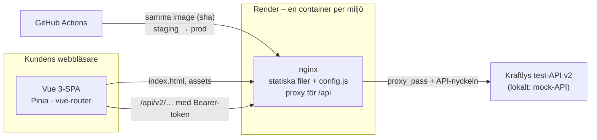
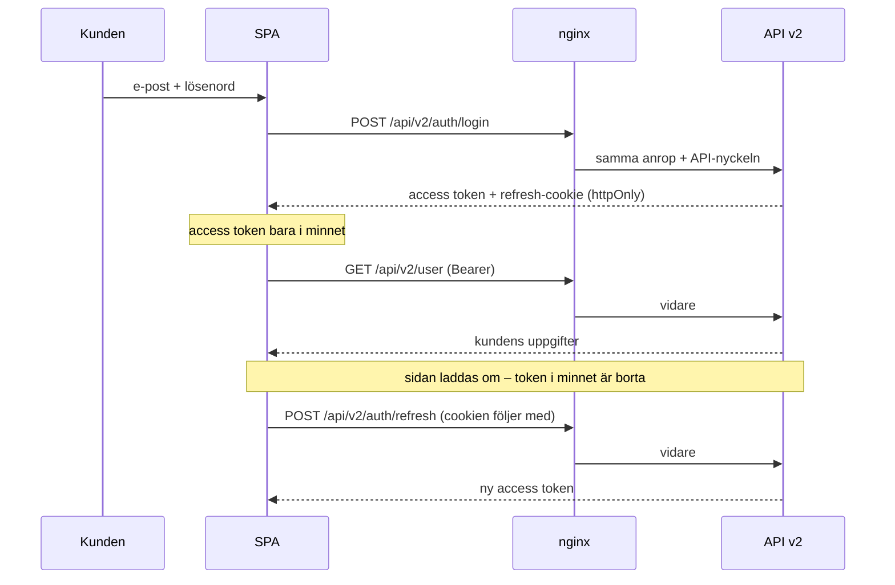

# Arkitektur

## Översikt

Portalen är en SPA: Vue-appen byggs till statiska filer som nginx serverar, och ingen kod körs på servern (se [`decisions/rendering.md`](decisions/rendering.md)). nginx är också proxy för `/api`, så webbläsaren pratar bara med en adress – samma origin, ingen CORS – och API-nyckeln läggs på av nginx och når aldrig webbläsaren. Eftersom containern bara serverar filer är den liten, startar snabbt och flaskhalsen ligger i API:t, inte hos oss (se [`scaling.md`](scaling.md)).

## Lagren i frontend

| Lager         | Ansvar                                                                                      | Regel                                                                                                               |
| ------------- | ------------------------------------------------------------------------------------------- | ------------------------------------------------------------------------------------------------------------------- |
| `views/`      | Sidorna routern känner till: översikt, fakturor, flyttanmälan, profil, inloggning           | Hämtar data via stores – **undantag:** `InvoicesView`, `MoveFormView` och `LoginView` anropar `services/api` direkt |
| `components/` | Återanvändbara delar: `KButton`, `KField`, `StatusChip`, `ConsumptionChart`, `NorwayNotice` | Vet ingenting om API:t – får data via props                                                                         |
| `stores/`     | Tillstånd som delas mellan vyer (Pinia): `user`, `consumption`                              | Anropar `services/`                                                                                                 |
| `services/`   | `api.js`: HTTP mot `/api/v2` · `token.js`: access token i minnet                            | Ingen Vue-kod                                                                                                       |
| `utils/`      | Rena funktioner: formatering, fakturastatus, validering, flaggor                            | Inga sidoeffekter – därför lätta att testa                                                                          |
| `router/`     | Rutterna och vakten som skickar utloggade till `/login`                                     | Väntar på `restoreSession()` (refresh mot cookien) innan den beslutar                                               |

Beroendena pekar nedåt: vy → store → service. Aldrig tvärtom.

Undantagen i `views/` är medvetna: fakturorna, flyttanmälan och inloggningen används bara på en sida var, så en store hade inte gjort något mer än att skicka vidare anropet.

## Ett flöde: inloggningen

Access token ligger aldrig i `localStorage`, så ett XSS-hål kan inte läsa ut den. Refresh-cookien är `httpOnly` och kan inte läsas av skript. Varför: [`decisions/tokenlagring.md`](decisions/tokenlagring.md).

## Miljöer

| Miljö        | Adress                                                        | Uppdateras                                 | Norge-flaggan                                | API                                    |
| ------------ | ------------------------------------------------------------- | ------------------------------------------ | -------------------------------------------- | -------------------------------------- |
| Dev (lokalt) | http://localhost:5173 (Vite) · http://localhost:8080 (Docker) | när du vill                                | på i Vite (`public/config.js`) · av i Docker | mock-API på `:4000`                    |
| Staging      | https://kraftly-watt-main.onrender.com                        | varje merge till `main`                    | på                                           | test-API:t `kraftly-api.sprinto.cloud` |
| Prod         | https://kraftly-watt.onrender.com                             | samma image som staging, efter godkännande | av                                           | test-API:t `kraftly-api.sprinto.cloud` |

Samma image går genom miljöerna – konfigurationen skiljer dem åt, inte koden. Detaljerna står i [`deploy.md`](deploy.md).

## Beslut

De tre viktigaste – alla beslut finns i [`docs/decisions/`](decisions/README.md):

- [Rendering](decisions/rendering.md) – SPA, inte SSR eller SSG: statiska filer bakom nginx, ingen server att drifta
- [Tokenlagring](decisions/tokenlagring.md) – access token i minnet, refresh i httpOnly-cookie
- [Feature flags](decisions/feature-flags.md) – Norge bakom en flagga som läses när containern startar, så imagen byggs bara en gång
