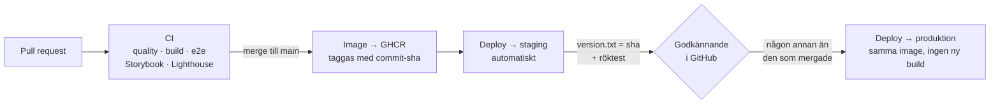

# Deploy – Kraftly Mina sidor

Hur en ändring går från en pull request till produktion, var varje hemlighet bor och hur man rullar tillbaka. Allt här styrs av `.github/workflows/ci.yml` och `.github/workflows/rollback.yml`.

## Flödet



Imagen byggs **en gång** och samma sha går genom staging och produktion. Det enda som skiljer miljöerna åt är miljövariablerna i Render.

## Miljöer

| Miljö          | URL                                    | Image                                      | API                                            | Uppdateras                                               |
| -------------- | -------------------------------------- | ------------------------------------------ | ---------------------------------------------- | -------------------------------------------------------- |
| Lokal (dev)    | `http://localhost:5173`                | –                                          | mock-API på `:4000` via Vite-proxyn            | manuellt: `npm run api` + `npm run dev` i två terminaler |
| Lokal (Docker) | `http://localhost:8080`                | byggs lokalt                               | mock-API på `http://api:4000` inne i compose   | `docker compose up --build`                              |
| Staging        | https://kraftly-watt-main.onrender.com | `ghcr.io/gahnejennifer/kraftly_watt:<sha>` | test-API:t `https://kraftly-api.sprinto.cloud` | automatiskt vid merge till `main`                        |
| Produktion     | https://kraftly-watt.onrender.com      | samma `<sha>` som staging just verifierat  | test-API:t `https://kraftly-api.sprinto.cloud` | efter godkännande i GitHub-miljön `production`           |

|                  | Staging                      | Produktion                  |
| ---------------- | ---------------------------- | --------------------------- |
| `APP_ENV`        | `staging` (miljöbanner syns) | `production` (ingen banner) |
| `FEATURE_NORWAY` | `true` – Norge-kortet syns   | ej satt – kortet syns inte  |

Båda Render-tjänsterna ligger på Jennifers konto, eftersom Hobby-planen bara tillåter en medlem. Pipelinen når dem via deploy-hooks som ligger i GitHub-miljöerna, så ingen annan behöver logga in i Render för en vanlig deploy.

## Konfiguration – var bor vad?

| Variabel             | Hemlig?         | Lokalt                                                       | Staging / produktion                                                                       | Används av                                                                   |
| -------------------- | --------------- | ------------------------------------------------------------ | ------------------------------------------------------------------------------------------ | ---------------------------------------------------------------------------- |
| `API_KEY`            | **Ja**          | `.env` – värdet i `.env.example` räcker mot mock-API:t       | Render → tjänsten → Environment (var sitt värde)                                           | Vite-proxyn / nginx, skickas som `X-Api-Key` till API:t. Når aldrig browsern |
| `API_URL`            | Nej             | `.env`: `http://localhost:4000` · compose: `http://api:4000` | Render → Environment: `https://kraftly-api.sprinto.cloud` (utan avslutande `/`)            | Vite-proxyn / nginx, proxar `/api/`                                          |
| `PORT`               | Nej             | `80` (satt i `Dockerfile`)                                   | Render sätter den själv                                                                    | nginx (`listen`)                                                             |
| `APP_ENV`            | Nej             | ej satt → `lokal`                                            | Render → Environment: `staging` / `production`                                             | `docker/40-runtime-config.sh` → `config.js` (miljöbannern)                   |
| `FEATURE_NORWAY`     | Nej             | ej satt → av                                                 | Render → Environment: `true` i staging, ej satt i produktion                               | `docker/40-runtime-config.sh` → `config.js`. Bara exakt `true` räknas som på |
| `RENDER_DEPLOY_HOOK` | **Ja**          | –                                                            | GitHub → Settings → Environments → `staging` **och** `production` → Secrets (var sin hook) | `deploy-staging`, `deploy-production` och `rollback.yml`                     |
| `STAGING_URL`        | Nej             | –                                                            | GitHub → Environments → `staging` → Variables                                              | väntan på `version.txt` + röktest                                            |
| `PROD_URL`           | Nej             | –                                                            | GitHub → Environments → `production` → Variables                                           | väntan på `version.txt` + röktest                                            |
| `GITHUB_TOKEN`       | Ja (automatisk) | –                                                            | skapas av GitHub Actions i varje körning                                                   | push av imagen till GHCR                                                     |
| `ANTHROPIC_API_KEY`  | **Ja**          | –                                                            | GitHub → Settings → Secrets → Actions                                                      | AI-granskningen (`ai-review.yml`)                                            |

### Hur får jag hemligheterna?

- **Lokalt behövs ingen riktig nyckel.** `cp .env.example .env` räcker, eftersom mock-API:t och Vite-proxyn använder samma lokala värde.
- **Teamnyckeln till test-API:t** delas ut av API:ts ägare (läraren/backend-teamet). Den läggs bara i Render → Environment, aldrig i repot, i chatten eller i en issue.
- **Deploy-hooks** hämtas i Render → tjänsten → Settings → _Deploy Hook_ och klistras in som secret i rätt GitHub-miljö. Byter ni Render-konto behöver båda hookarna bytas.
- **Åtkomst:** Render-kontot ägs av Jennifer. GitHub-miljöerna och deras secrets kräver admin i repot.

## En ändring till produktion

1. Öppna en PR. Alla required checks ska vara gröna och en annan person ska godkänna.
2. Merga till `main`. CI bygger imagen, pushar den till GHCR med commitens sha och deployar till staging.
3. `deploy-staging` väntar tills `https://kraftly-watt-main.onrender.com/version.txt` visar samma sha och kör ett röktest genom proxyn.
4. `deploy-production` stannar på **Review deployments** i Actions. Någon i teamet som **inte** mergade godkänner (Prevent self-review är på).
5. Samma image deployas till produktion. Jobbet väntar på rätt sha i `https://kraftly-watt.onrender.com/version.txt` och röktestet blir rött om Norge-flaggan skulle vara på i produktion.

Kontrollera själv efteråt:

```bash
curl https://kraftly-watt-main.onrender.com/version.txt
curl https://kraftly-watt.onrender.com/version.txt
git rev-parse HEAD          # alla tre ska visa samma sha
```

## Rollback

Varje image i GHCR är taggad med sin commit-sha. En rollback är en deploy av en äldre tagg – ingen ny build, inga kodändringar.

1. Hitta sha:n för senaste fungerande version (Actions → en grön körning, eller `git log`).
2. Actions → **Rollback** → **Run workflow** → välj miljö (`staging` eller `production`) → klistra in hela sha:n → **Run workflow**.
3. Väljer du `production` stannar jobbet på godkännande, precis som en vanlig prod-deploy.
4. Jobbet väntar tills `version.txt` visar den gamla sha:n och blir grönt.
5. **Tillbaka till nuläget:** Actions → **CI** → **Run workflow** på `main`, eller en rollback med den senaste sha:n.

**Vad som inte backar:** miljövariablerna i Render (`API_KEY`, `APP_ENV`, `FEATURE_NORWAY`), koden på `main` och imagerna i GHCR. En rollback byter bara vilken image som körs.

**Genomförd:** staging till M4-sha `af6194d`, 25 s till ✅ – [körningen](https://github.com/gahnejennifer/Kraftly_Watt/actions/runs/36113248484). Mer i `docs/milestones.md` under M5.

Använd inte Renders egen knapp _Rollback to this deploy_ – den går förbi godkännandet i GitHub och syns inte i Actions.

## API-nyckeln

- **Byråns nyckel** låg hårdkodad i `src/services/api.js` när vi tog över. Den togs ut ur koden i M4 och roterades, så den ger 401 i dag.
- **29/10 roterades teamnyckeln igen**, efter att den hittats i klartext i en curl-utskrift i den här filen. Den nya nyckeln finns bara i Render → Environment och skrivs inte ut någonstans i repot.
- **Historiken skrevs inte om.** Båda nycklarna är roterade och därför värdelösa. Att skriva om historiken i ett delat repo med aktiva brancher och en körande pipeline (force-push, trasiga PR:ar, alla måste klona om) är en större risk än en död nyckel i historiken. Rotationen är skyddet – inte att nyckeln försvinner ur git.

Så verifierar ni att en nyckel är död, utan att skriva ut den:

```bash
curl -s -o /dev/null -w "%{http_code}\n" -H "X-Api-Key: $GAMMAL_NYCKEL" https://kraftly-api.sprinto.cloud/api/v2/user
# 401 = nyckeln fungerar inte längre
```

## Tider (uppmätta)

| Steg                                  | Tid        |
| ------------------------------------- | ---------- |
| Merge → imagen publicerad             | 1 min 45 s |
| Hook → rätt sha svarar i staging      | 31 s       |
| Totalt merge → staging                | 2 min 16 s |
| Rollback, Run workflow → ✅ (staging) | 25 s       |
| Kallstart efter 15+ min utan trafik   | 38 s       |

## Kända begränsningar

- **Kallstart:** Render Free sover efter 15 minuter utan trafik. Första anropet tar runt 38 s. Accepterat för staging, och väck produktion innan en demo.
- **Ett Render-konto:** Jennifer äger båda tjänsterna. Försvinner kontot behöver tjänsterna, båda deploy-hookarna och `API_KEY` sättas upp på nytt – imagen och `nginx.conf.template` är leverantörsoberoende.
- **arm64 och amd64:** vi bygger lokalt på Apple Silicon, men Render kör amd64. CI bygger på `ubuntu-latest` (amd64), så imagen som deployas är rätt.
- **Ingen egen prod-nyckel:** staging och produktion använder samma test-API. I ett riktigt projekt hade produktion haft ett eget API och en egen nyckel.
