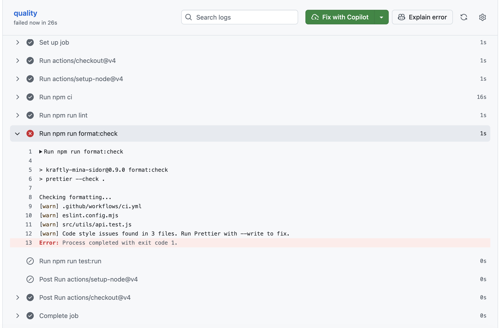

## Datum: 2026-08-21

Ilona, Natassja, Jennifer hade avstämning och gjorde klart setupen med codeowners, checkade PR-mallen och work agreement.
Satte upp dokument för milestones, log och skuldinventering. Vi bestämde att vi kommer att göra skuldinventeringen individuellt eftersom vi kan arbeta olika tider och att vi stämmer av med varandra på tisdag hur det gått och fyller på loggen då. Ilona och Truc kommer till dess köra repot lokalt och testa att det fungerar för dem också.
**Svårt:** Att veta om vi gjort rätt på codeowners och om alla ska stå med där varje vecka oavsett vem som är techlead.

## Datum: 2026-08-25

Ilona, Natassja, Truc, Jennifer stämde av vad vi alla hade hittat under skuldinventeringen och diskuterade det vi hittat. Sen sammanfattade vi det tillsammans och stämde av att appen fungerade lokalt för alla i teamet.
**Svårt:** Vi upplevde att det var lite svårt att veta exakt vad som förväntas göra vid en skuldinventering, om det är allt som kan förbättras med appen eller om det bara avser buggar man hittar i koden. Vi hade gärna fått mer instruktioner på vad som förväntades och vad vi ska titta efter. Det hade vi gärna fått vid framtida uppgifter. Det är svårt att ta över någon annans kod, jättebra att vi får öva på det.

## Datum: 2026-08-28 · Boiler Room 1

**Gjort:** Vi började dagen med att gå igenom vad vi tidigare fått gjort eftersom alla i gruppe inte varit med, så att vi alla var uppsjungna på det senaste. Vi jobbade också vidare på gårdagens uppgift. Sen satt vi individuellt och letade efter tester som vi skulle kunna skriva i M1. Vi gjorde sen 2 tester, varav det ena var ett enhetstest och det andra ett komponenttest. Eftersom det andra var ett komponenttest har vi också satt upp jsdom osv för att få komponenttestning att fungera. Vi har ockås testat E2E i både Cypress och Playwright där vi tillslut valde Cypress och motiverade det. När vi testade så jämförde vi de olika verktygen och satte tillsammans upp båda verktygen då vi inte var tillräckligt många för att dela upp oss.

**Grönt:** … (länkar till PR:ar)

- https://github.com/gahnejennifer/Kraftly_Watt/pull/11
- https://github.com/gahnejennifer/Kraftly_Watt/pull/12
- https://github.com/gahnejennifer/Kraftly_Watt/pull/13
- https://github.com/gahnejennifer/Kraftly_Watt/pull/14
- https://github.com/gahnejennifer/Kraftly_Watt/pull/15
- https://github.com/gahnejennifer/Kraftly_Watt/pull/16

Kvar till M1-taggen tisdag:

- 3st test på egna findings (7/10 klara)
- Minst ett regressionstest på en bugg ur vår docs/debt.md
- ESLint + Prettier körs i pre-commit
- Teststrategi i docs/testing.md

**E2E:** valde Cypress · smoke + mockat test gröna: ja

**Fastnat på:** Att hitta rätt bland instruktionerna, det var lite uppdelat och därmed svårt att helt förstå uppgifterna. Vi fastnade vid E2E på att det saknades beskrivning på hur exakt man skulle gå tillväga med att lägga upp mapparna, vart script skulle läggas in osv. Vi hade gärna velat få en genomgång på hur E2E-testning fungerar i praktiken innan vi gjorde detta själva, men vi förstår att det var en del av uppgiften att försöka sätta upp det själva.

## Datum: 2026-08-31

Truc, Ilona & Jennifer sågs i skolan och jobbade tillsammans på branch "Teamdag" där vi fyllde i teststrategin med alla parametrar. Vi gjorde även resterande tester som vi hade kvar på M1 (varav 1 regressionstest). Vi fyllde i milestones för M1 och blev klara med samtliga delar. Vi gick också igenom PR som vi hade för vissa fixar.

## Datum: 2026-09-03

Truc, Ilona och Jennifer jobbade under lektionstid på Övning 3 som innehöll delar av M2. Vi satte upp pipelinen för Kraftlyprojektet, såg till att Cypress E2E fungerar på Github Actions, satte upp grinden med rulesets och skrev pipeline.md. Sen testade vi också att grinden fungerar genom att verifiera det live med ett medvetet lintfel. Det fungerade! Vi la också till en badge överst i vår README som blir grön/röd live utifrån om main är grön eller inte.

**Screenshots från delar av det vi gjorde:**

## Datum: 2026-09-04

Truc och Jennifer hördes på Slack för att jobba vidare på M2 på de delar som kvarstår vilket var att lägga in PR på när grinden stoppade vårt medvetna lintfel, samt strukturera upp de printar vi tog igår så att allt låg rätt i pipeline.md och logen. Vi testade även att kika på hur lång tid npm ci tog på build och quality eftersom vi ville vara säkra på att vi kört flera gånger med cache igår när vi skulle skriva upp tiderna i tabellen. Eftersom det är fredag verkar det som att många kör Github Actions och därför tog det runt 6-7 minuter när vi körde, vilket inte riktigt gick att använda till mätningen. Vi såg i alla fall att cachen fungerar perfekt. På rad 24–25: "Cache restored successfully" och "Cache restored from key: node-cache-Linux-x64-npm-...", med en cache på ~36MB nedladdad på under en sekund (29.8 MB/sec). Det är alltså inte ett cache-miss-problem. Nu har vi redan gjort en mätning tidigare när vi körde med cache två ggr men vi ville testa en gång till för att säkerställa mätningen.

## Överlämning techlead - V3, inför M3

Jag (Jennifer) har nu varit techlead i tre veckor under M0, M1 och M2 och kommer nu lämna över till Natassja som techlead.
**Vad som är igång:**
CI-pipelinen (quality, build, e2e) är uppe och grön på main, med ruleset, badge och grinden verifierad via en riktig röd→grön PR (#28). Alla DoD-punkter för M2 är uppfyllda, inklusive npm-cache-mätningen i docs/pipeline.md. Däremot så upplevde vi att mätningen visade minimal skillnad mellan med/utan cache och därför vill vi köra om den mätningen. Cachen fungerar (bekräftat i loggarna, Cache restored successfully), men npm ci-tiderna har varit ovanligt höga (5–6 min) nu vid senaste körningarna, troligen på grund av hög belastning på GitHub Actions/npm-registret en fredag. Därför kan det vara bra att göra en ny körning för att säkerställa att print två som vi har i pipeline.md inte är från första körningen efter att cachen slogs på (den som fyller cachen).

**Vad som skaver:**
Vi tappade bort ändringar en gång genom att fortsätta committa på en branch (E2E-jobbet) efter att den redan var mergad — de nya commiterna (skärmdumpar, dokumentation) hamnade aldrig på main förrän vi upptäckte det och öppnade en ny PR. Vi behöver bli bättre på att radera feature-branches direkt efter merge och skapa en ny branch per uppgift, istället för att återanvända en gammal. Kanske kan det även vara en idé att radera gamla branches i VS-code lokalt?

**Beslut att ompröva:**
Beslut 3 (protokoll vid röd main: 15 minuter att laga framåt, annars revert) är hittills bara teori — vi har inte haft en riktig incident att testa det på. Nästa tech lead bör hålla koll på om 15 minuter känns rimligt i praktiken första gången main faktiskt blir röd på riktigt, och justera om det behövs.

## Datum: 2026-09-10

Ny techlead skulle vara Natassja men vi har bytt och det blir istället Truc som tar över kommande 3 veckor. Vi satte upp Docker i projektet och då fastnade vi på att få docker compose up --build att fungera. Eftersom vårt API inte låg i nginx.conf och att vi behövde lägga till .env-files i docker.compose.yml göt att få det att fungera. När vi skulle få det att fungera på de andra datorerna som inte skrivit koden under dagens uppgifter så stötte vi på problem. En i teamet hade då en annan server uppe på docker och då kunde docker inte nå 4000 eftersom den var upptagen. Vi fick då köra netstat -ano | findstr :4000 och taskkill /PID 40244 /F. För att vara lite proaktiva såg vi till att lägga till tydliga instruktioner i README så att nästa teammedlem enkelt kan sätta upp docker på deras dator och få allt att fungera direkt.

## Datum: 2026-09-11

Jennifer var inte med igår och försökte idag köra docker compose up --build vilket inte fungerade: docker compose up fungerar hos den som skrev filen men inte i ett rent klon. Efter att vi pushat instuktionerna i README fungerade det. Vi har nu säkrat att tilläggen i M3 fungerar för samtliga i teamet. Vi löste också mappstrukturen så att pull_request_template.md triggas igen när en PR skapas.

## Datum: 2026-09-14

Vi taggade M3 innan lunch men fick sen nya instruktioner. Efter att ha läst igenom allt insåg vi att det såg bra ut förutom lite småfix i vår README (vi hade råkat skriva port 8000 ist för 8080), samt att vi missat bocka i en del i milestones efter att vi la in containers.md. Vi ändrade också lite i vårt beslut nr 3 i containers.md.

## Datum: 2026-09-17

Vi delade upp oss för att dels ta ur nyckeln ur koden som vi ärvt samtidigt som vi satte upp pipelinens deployflöde. Tillsammans satte vi upp ett renderkonto på Jennifer och la in API-nyckeln och API-url:en. För att testa att gamla API-nyckeln är död så gjorde vi ett curltest både med och utan nyckeln. Vi la till Image → GHCR som ytterligare en check i vårt ruleset på Github och såg till att det blev grönt. Därefter testade vi också att vi fick grönt i Pipelinen på deployflödet med Render. Eftersom vi hade skrivit ett test (api.js) för att kolla om API hämtas från env och inte är hårdkodad, så failade testet efter att vi gjorde ändringarna för API. Lösningen blev att lägga till ett värde för BASE_URL istället för ''. Efter det blev pipelinen grön.

## Datum: 2026-09-18

Idag arbetade vi vidare med M4 och dokumentationen för deployment. Vi färdigställde och gick igenom docs/deploy.md, där vi kollade på tidsåtgången för testerna vid deploy. Vi jämförde olika hostingalternativ och tog beslutet att använda oss av Render för produktionen.
Vi tog beslutet att ta bort testet api.test.js eftersom det testet inte längre tillför något nu när vi flyttat API-nyckeln. Det var en snabbfix vi gjorde igår men vi vill säkerställa att vi inte har onödiga test/inaktuella test. För att säkerställa att alla delar av M4 var kara så checkade vi av milestones också. Uppdatering av getting started är nu uppdaterat med cp .env.example .env och vi la till en stagingdel också i README. Den sista delen vi hade kvar i M4 var att testa på en ren klon. Vi upptäckte då att vi inte kunde logga in och började felsökning. Vi har efter lite fix insett att vi gjort något steg tokigt igår (1.7).

## Datum: 2026-09-24

Vi arbetade parallellt på tre spår där en person (med tillgång till Render-kontot) satte vi upp produktionsmiljön i Render. En annan la till en norge-flagga på staging och kontrollerade att den inte syntes i prod. En tredje la till cache-mätning och gjorde mätning på före och efter cache. Tillsammans skrev vi sen allihop på scaling.md samt feature-flags.md utifrån våra beslut och hur vi arbetat.

## Datum: 2026-09-25

Samlades digitalt vid 9 och fyllde på milestones med DoD för M5, checkade av det vi gjort hitintills och la in bevisen från gårdagen.

**Chechpoint 9:00** - Prod visar samma innehåll som staging förutom Norge-flaggan och bannern högst upp, samt prod-deployen med godkännande och rollback.yml finns på main och visas i Github. Vi är redo inför förmiddagens rollback och kommer att göra den tillsammans eftersom vi igår blev klara med de delar av M5 som kunde delas upp.

**Checkpoint 12:00** - https://github.com/gahnejennifer/Kraftly_Watt/actions/runs/36113248484 Rollbacken är gjord och vi har gått tillbaka till nya versionen igen.

## Datum: 2026-10-01

Från idag är Ilona nästa tech-lead för kommande 3 veckor. Spår 1 och spår 3 körde vi parallelt, men väntade med spår 2 för att udvika en merge konflikt. Jennifer satt med spår 2 och fixade att appen pratar med v2 och att API:et släpper inte fram data utan token. Ilona satt med spår 1 och gjorde så att token ligger i minnet inte i localStorage. Truc gjorde spår 3 där hon satte upp CSP med säkerhetsheaders på varje spår och CORS så att en sida inte får läsa svar från en annan adress om inte API:et tillåter just den adressen (CSRF attacken ex.).

## Datum: 2026-10-02

Samlades digitalt vid 9 och fyllde på milestones med DoD för M6, checkade av det vi gjort hitintills och la in bevisen från gårdagen. Vi fyllde tokenlagring.md med våra beslut och motiveringar.

## Datum: 2026-10-16

M8 – Komponentbibliotek. Jennifer och Natassja jobbade, Ilona (tech lead) och Truc var borta. Övning 3 publicerades först under förmiddagen, så vi började med att titta på klipp 3 (axe) och lägga upp arbetet utifrån uppgiften.

Jennifer gjorde verktygen (Storybook + jest-axe, #90), spår 1 (KButton, #93 och #98) och spår 3 (fokus och lang #94, kontrast #95, tabell och alt #97). Natassja gjorde tangentbordsgenomgången före (#92) och spår 2 (labels och inloggningstestet, #96, #99, #100).

**Svårt / lärdomar:**

- Vår portal skiljer sig från övningens startkod: ingen `tests/setup.js`, ingen StatusChip-komponent, och fälten i flyttanmälan saknade labels.
- `@pinia/testing` kräver Pinia 4 och vi har Pinia 2, så inloggningstestet körs utan den.
- Testing Library städade inte mellan testerna (vi har inte `globals: true`). Det löstes med `cleanup()` i `tests/setup.js`.
- ESLint granskade `storybook-static/` lokalt (29 000 fel). Mappen är nu ignorerad.
- Tab nådde inga knappar på en av våra datorer, inte ens på en tom testsida, så det var datorn och inte koden.

**Kvar till taggen:** tangentbordsgenomgången efter (Natassja), utdrag ur `test:a11y` och `test:run` på main, taggen och överlämningen till nästa tech lead.

## Datum: 2026-10-20 • Överlämning techlead inför M9

Överlämning från Ilona till nästa tech lead (Natassja) efter M8.

M8 är klar: alla DoD-punkter är bockade i `docs/milestones.md`, Natassjas tangentbordsgenomgång efter är mergad (#102), och axe-testerna och Storybook-kontrollerna är gröna på main. Hero-bildens alt-text är kvar som känd brist i `docs/accessibility.md`. Vi beslutade att det duger för M8.

Kvar: taggen M8 på main när pipelinen är grön. Jennifer kommer tagga åt Ilona (bortrest).

Till M9 (Storybook och axe i pipelinen): det är inte gjort än. Nästa tech lead: Natassja.

Öppna saker att titta på i M9:

- Enter i textfälten skickar inte formulären (saknar `<form>`).
- Fokus flyttas inte vid ruttbyte.
- Felen i flyttanmälan visas med `alert()` och är inte kopplade till fälten.
- Skärmläsare och zoom till 200 % är inte testade.

## 2026-10-22 · AI-granskaren + issue till Boiler Room 3

- **Gjort:**
- Satte upp en AI-granskare i GitHub Actions (`scripts/ai-review.mjs` + `ai-review.yml`, #104). Testade den på övningens test-PR med kända fel, bedömde om det var träff, miss eller oavgjord och ändrade en regel i systemprompten. Första riktiga PR:en med AI-kommentar var #107. Dokumentationen ligger i `docs/ai-in-pipeline.md` (#108).
- Gjorde också en issue med planen inför Boiler Room 3.
- M9-rubriken i `docs/milestones.md` med DoD 3 avbockad (#110)

## 2026-10-23 · Boiler Room 3

- **Gjort:**
- Vi lade till ett Storybook-jobb i pipelinen som nu är en required check på main (#111).
- Vi byggde KField, ett textfält där labeln är obligatorisk och där hjälptext och fel kopplas till fältet med `aria-describedby`, med story och axe-test (#112). KFields story visade Violations 0 i Accessibility-fliken. Skärmdumpar ligger i `docs/screenshots/`.
- AI-granskningen kunde inte köras eftersom API-nyckeln hade bytts (401), men den blockerade inte merge eftersom den inte är en required check. Den kördes vid senare tillfälle.
- La in bevis för Storybook-delen av DoD 1 i milestones.md.
- **Grönt:** [#111 Storybook-jobbet](https://github.com/gahnejennifer/Kraftly_Watt/pull/111) ([körningen](https://github.com/gahnejennifer/Kraftly_Watt/actions/runs/39794501322/job/119878334177)) · [#112 KField](https://github.com/gahnejennifer/Kraftly_Watt/pull/112) · Tests 4 passed (4) · Violations 0 i Storybook
- **Kvar av Boiler Room:** byta in KField i inloggning, profil och flyttanmälan
- **Kvar till M9-taggen tisdag:** byta in KField i inloggning, profil och flyttanmälan · KField-bevisen i `docs/milestones.md` · AI-utvärderingen
- **En siffra från i dag:** 4/4 tester gröna för KField.
- **Fastnat på:** att hitta Accessibility-fliken i Storybook.

## 2026-10-26 · Boiler Room 3

- **Gjort:**
- KField inbytt i inloggning och profil, `label`-stilen borttagen ur vyerna (#113)
- `<form>` i inloggning och profil, så att Enter skickar formulären. Känd brist från M8 (#114)
- **Grönt:** [#113 KField i inloggning och profil](https://github.com/gahnejennifer/Kraftly_Watt/pull/113) · [#114 Enter skickar formulären](https://github.com/gahnejennifer/Kraftly_Watt/pull/114)
- **Kvar av Boiler Room:** KField i flyttanmälan
- **Kvar till M9-taggen tisdag:** KField i flyttanmälan · KField-bevisen i `docs/milestones.md` · AI-utvärderingen i `docs/ai-in-pipeline.md`
- **En siffra från i dag:** Storybook byggs lokalt på 3,5 s. Portalen väger 265 kB per besök efter M7 (491 kB före).
- **Fastnat på:**
- AI-nyckeln: teamnyckeln gav 401 på #112 i fredags. Den nya nyckeln fungerade 12:48–12:53 måndag och gav sedan 401 igen, troligen för att en delad nyckel läckte i en annan grupps PR och spärrades. #114 saknar därför AI-kommentar. Steget blockerade inte, eftersom det inte är required.
- Lokal inloggning gav 401/429: en gammal server från ett annat projekt låg kvar på port 4000. Löst genom att flytta mock-API:t till port 4001 i `.env`.
- `node scripts/ai-review.mjs` hittade inte `@anthropic-ai/sdk` lokalt. Löst med `npm ci`.

## 2026-10-27 · Boiler Room 3 och M9

- **Gjort från Boiler Room:**
  Vi gjorde klart flyttanmälan som nu använder KField för Ny adress, Postnummer, Ort och Inflyttningsdatum (#115). Felen visas vid sitt fält i stället för i en `alert()`, och skärmläsaren läser upp dem när fältet får fokus. Testet `MoveFormView.a11y.test.js` var först rött (`toBeInvalid()` föll) och blev grönt efter ändringen. Därmed används KField i alla tre vyerna. Boiler Room klar!

- **Gjort klart M9:**
  Fokus flyttas nu till sidans `<h1>` vid sidbyte, en känd brist från M8 och en av de valfria punkterna i M9 (#116). Vi bedömde AI-granskningens kommentarer på 6 PR:ar som träff, miss eller oavgjord och skrev två exempel och vår regel i `docs/ai-in-pipeline.md`. Vi svarade också i tråden på #114, där AI:n hade fel om Ångra-knappen. Till sist fyllde vi i bevisen under M9 i `docs/milestones.md`.

- **Grönt:**
  `npm run test:run` på main: 16 testfiler, 40 tester. `npm run build-storybook` lyckas. Sista CI-körningen för #115, med jobbet Storybook grönt: [körning 40534757944](https://github.com/gahnejennifer/Kraftly_Watt/actions/runs/40534757944).

- **En siffra från i dag:**
  12 AI-granskningar på 6 PR:ar gav 5 träffar och 3 missar. Två av tre lyckade körningar på samma diff i #112 sa "Inget att anmärka på", den tredje hittade ett riktigt fel.

- **Fastnat på:**
  CI föll på `npm ci` i #115 eftersom `npm update` gjorde `package-lock.json` osynkad. Löst. Lighthouse-budgeten för JS på /login sprack med 40 byte (45 040 mot 45 000) i #116, och vi höjde den medvetet till 47 kB och skrev varför i `docs/performance.md`. AI-nyckeln gav 401 flera gånger. Steget blockerade inget, eftersom det inte är required.
